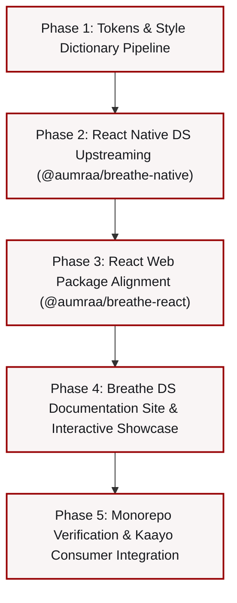

# Kaayo Design System Modernization Plan
## Updating Breathe Design System to Kaayo v1.8.0 ("Neobrutalism × Skeuomorphism 2.0")

---

## 1. Executive Summary & Context

Kaayo's frontend (`D:\Aumraa\APOS pitch\1_Product Factory\01_Kaayo\Product\Development\version 1\frontend`) has undergone a major design system evolution, codified in mid-October 2026 (release v1.8.0). 

It moved beyond standard flat Neo-Brutalism into an expressive, culturally anchored hybrid aesthetic:
> **"Neobrutalism × Skeuomorphism 2.0"** — Blending tactile, high-contrast brutalist structure (2px ink borders, mechanical presses, bold type) with ambient soft clay surfaces (dual blurred brand-tinted shadows, 24px/pill radii, skeuomorphic dials, knobs, grooves) and traditional Warli folk art motifs.

**Breathe Design System** (`D:\Aumraa\APOS pitch\1_Product Factory\00_Breathe Design system`) is currently lagging behind:
1. **Tokens (`tokens/src/kaayo.json`)**: Contains only flat primitive colors and basic hard shadows; completely lacks `kayoClay` definitions, tinted shadows, drop shadows, motion tokens, and the 13.4 typography roles.
2. **React Native Package (`@aumraa/breathe-native`)**: Contains **zero** Kaayo components (currently only supports Lemniscate atoms). Kaayo was forced to maintain its entire 89-component design system locally in `frontend/design-system/`.
3. **React Web Package (`@aumraa/breathe-react`)**: Contains 54 older web-adapted components (`KayoBrutalist*.tsx`) from July/August 2026 that have hardcoded styles, no claymorphism, and miss over 20 newly created atoms and molecules.
4. **Documentation Site (`src/app/`)**: Does not document or showcase the dual-material system, clay elevation, notifier feedback taxonomy, or the new components.

---

## 2. Phase-by-Phase Roadmap

To ensure zero regression, maximum clarity, and bite-sized verifiable deliverables, the work is divided into **5 sequential phases**. Each phase is designed to be executed in its own dedicated session.



| Phase | Title | Primary Scope | Dedicated Guide |
|---|---|---|---|
| **Phase 1** | **Tokens & Style Dictionary Pipeline** | `tokens/src/kaayo.json`, Style Dictionary config, compilation of CSS/JS/Native tokens, clay tokens, notifier taxonomy, typography | [`01_Phase_1_Tokens_and_Foundations.md`](./01_Phase_1_Tokens_and_Foundations.md) |
| **Phase 2** | **React Native DS Upstreaming** | `@aumraa/breathe-native`, porting 41 atomic components, molecules, organisms, templates, and guard tests from Kaayo | [`02_Phase_2_React_Native_Package.md`](./02_Phase_2_React_Native_Package.md) |
| **Phase 3** | **React Web Package Alignment** | `@aumraa/breathe-react/kaayo`, modernizing web components to Neobrutalism × Skeuomorphism 2.0, adding web clay & Warli primitives | [`03_Phase_3_React_Web_Alignment.md`](./03_Phase_3_React_Web_Alignment.md) |
| **Phase 4** | **Documentation Site & Showcase** | Breathe Docs Site (`src/app/`): ElevationPage (Soft Clay demos), ColorsPage, TypographyPage, new component pages, Android mockup | [`04_Phase_4_Docs_and_Showcase.md`](./04_Phase_4_Docs_and_Showcase.md) |
| **Phase 5** | **Testing, Verification & Hand-off** | End-to-end linting, typechecks, guard tests, and wiring the Kaayo product to consume `@aumraa/breathe-native` | [`05_Phase_5_Integration_and_Verification.md`](./05_Phase_5_Integration_and_Verification.md) |

---

## 3. How to Execute in Separate Chats

When starting a new session for a specific phase, use the following standardized prompt template:

```markdown
We are working on updating Breathe Design System with Kaayo's latest design system.
Please refer to the phase guide:
docs/Kaayo Design system updates/0X_Phase_X_<Title>.md

Previous Chat Summary:
<Paste the completed checklist and notes from the previous phase>

Goal for this chat:
Execute all tasks defined in Phase X according to its specification.
Do not modify files outside this phase's scope.
Verify with the phase's test checklist before finishing.
```

---

## 4. Key Architectural Decisions (To Preserve Across All Chats)

1. **Two Materials Coexist**:
   - **Brutalist Structure**: 2px solid ink border (`Neutral/950`) or 1.5px tonal border (900 stop), hard offset shadow (2–8px, 0 blur), radius $\le 12\text{px}$. Used for action-holding cards, primary buttons, structural chrome.
   - **Soft Clay (Ambient & Controls)**: No border (or hairline rim), blurred dual shadows with light source top-left, **opaque brand tints only** (`Secondary/200` shade + `Neutral/25` light), 24px radius for surfaces, pill (999) for controls. Never grey, never rgba.
2. **Chip vs Badge Distinction**:
   - `Badge`: Outlined status indicator (Active, Overdue, NOT PAID) $\rightarrow$ **UPPERCASE with 5% letter-spacing**.
   - `Chip`: Soft inset info chip $\rightarrow$ **Sentence case with 0 tracking** (`utility_badge_sentence`).
3. **Strict Picker Pattern**:
   - Dates, times, and months are **never typed** into text fields. They always invoke native/modal pickers (`DateField`, `TimeField`, `MonthField`, `MonthPicker`).
4. **Cultural Integrity**:
   - `WarliVeil` for financial privacy masking (using diamond-with-dot glyphs).
   - `CanopyBand` for tab-specific Warli animations (Dashboard zigzags, Students waves, Attendance triangles, Payments sprouts).
5. **No Regressions for Other Products**:
   - Lemniscate, Technocracy, Maligai, and Aumraa tokens and components must remain fully intact.

